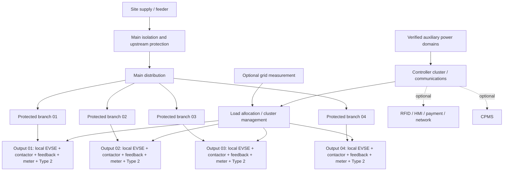

# Charger Hardware V1 — M1.19 Modular Electrical Architecture and Interface Boundaries

**Status:** CONCEPTUAL ENGINEERING BASELINE / OPEN FOR REVIEW  
**Date:** 2026-11-12  
**Scope:** Functional electrical architecture for Single, Dual, Quad and Wallbox AC charging variants.  
**Depends on:** M1.6–M1.18, especially the CHARX cluster limitations, meter architecture, supplier RFI and independent validation matrix.

> This document defines functional boundaries and design obligations. It is not a terminal-level wiring schedule, certified single-line diagram, installation design, production BOM or permission to energise mains equipment.

## 1. Objective and design rule

Create one repeatable output-cell architecture that scales from one to multiple Type 2 AC charging points without weakening the safety boundary of any output.

**Non-negotiable rule:** each charging output has its own locally enforced EVSE safety/control path, switching element and feedback, CP/PP interface, fault state and (where commercial energy attribution requires it) individually attributable meter. A shared controller, gateway, load manager, CPMS or payment service must not bypass or replace these local functions.

A shared controller cluster may create common-cause dependencies. Until tests prove otherwise, a four-output CHARX cluster is four locally controlled outputs in a shared system—not four fully autonomous chargers.

## 2. Functional architecture

### 2.1 System-level domains

| Domain | Function | Boundary / rule |
|---|---|---|
| GRID-IN | Site feeder connection and declared supply characteristics | Defined by installation design and available fault level |
| MAIN-DIST | Main isolation, upstream protection and distribution | Device ratings and coordination remain project-specific |
| GRID-SENSE | Optional site/grid measurement for dynamic load management | Not a substitute for per-output energy attribution |
| OUTPUT-n POWER | One protected power branch per charging output | Branch fault must not silently disable or energise another output |
| OUTPUT-n EVSE | Local EVSE control, CP/PP, contactor command/feedback and local safety inputs | Must reach a safe state without cloud/CPMS availability |
| OUTPUT-n METER | Metering uniquely attributable to output n | Legal/commercial use requires certificate and deployment approval |
| AUX-CONTROL | Controller and approved backplane supply | Respect manufacturer voltage/current limits, including 6 A nominal CHARX backplane ceiling |
| AUX-12V | Peripheral/SELV auxiliary loads | Separate verified load budget; no assumed spare capacity |
| COIL-n | Contactor coil supply and suppression | Validate coil inrush, hold current, switching and feedback |
| SAFETY-n | RCM/RCD coordination, temperature, interlocks and stop chain | Exact protection architecture requires competent design |
| COMMS | Ethernet, LTE, Wi-Fi, RS-485 and service links | Segregate from mains and safety interfaces as required |
| ID/PAYMENT | RFID, payment terminal, QR/payment service and HMI | Optional commercial interfaces; never part of the protective safety chain |
| CPMS | Remote supervision, authorisation and commercial operations | Loss must not defeat local electrical safety |

### 2.2 Conceptual block diagram

The diagram is functional only. It does not show protective-device order, neutral switching, conductor routing, RCD type, pole count, protective coordination or terminal positions. These must be resolved from the selected devices, applicable standards and installation conditions.

## 3. Repeatable output cell

Each output cell (n = 01…N) shall have a uniquely identified set of interfaces and evidence:

1. **Power input:** branch supply from the distribution assembly, with protective coordination established for that branch.
2. **Local EVSE controller:** controller/module responsible for that output's charging state and CP signalling.
3. **CP/PP:** manufacturer-approved interface to the Type 2 connector; no raw MCU GPIO connection to the vehicle interface.
4. **Switching:** output-specific contactor or approved switching device, commanded by the local EVSE function.
5. **Feedback:** independently observed contactor state/auxiliary feedback as supported by the selected architecture; define detection of failure to open/close and welded-contact response.
6. **Meter:** dedicated meter or certified measurement channel with unambiguous output identity when energy is commercially attributed to that output.
7. **Protective sensing:** output-specific RCM/temperature/interlock inputs where required by the selected protection concept.
8. **Connector:** Type 2 outlet/cable assembly and locking arrangement with exact manufacturer interface evidence.
9. **Identity:** immutable internal output ID used consistently by controller, meter, logs, CPMS and service records.
10. **Safe state:** defined local response to critical sensor, controller, switching, communication and power faults.

No signal from a different output may be treated as proof of this output's contactor state, meter identity or protective condition.

## 4. Variant scaling rules

| Variant | Functional composition | Shared elements | Mandatory independent elements |
|---|---|---|---|
| Single | 1 distribution branch + 1 output cell | Enclosure, optional gateway and site interface | Output protection, EVSE function, switching/feedback, CP/PP, safety response, meter where required |
| Wallbox | Same functional composition as Single | Compact enclosure, mounting and cable management | Same output-cell requirements; enclosure geometry does not relax electrical requirements |
| Dual | 1 supply/distribution assembly + 2 output cells | Upstream isolation, optional grid sensing, load allocator, optional comms | Two separately identified output branches and two local output-cell functions |
| Quad | 1 supply/distribution assembly + 4 output cells | Upstream services, optional grid sensing, shared controller cluster and optional commercial modules | Four separately identified output branches and four local output-cell functions |
| MultiStation | Multiple charger assemblies under site/master coordination | Site-level load allocation, CPMS and shared payment/service if designed | Every charging output retains its own local safety and switching boundary |

The table is a functional scaling model, not proof that a particular controller family supports every variant. Controller count and cluster arrangement remain conditional on manufacturer confirmation and M1.18 bench acceptance.

### 4.1 CHARX-specific constraint carried forward

The current study topology for four points is one SEC-3xxx plus three SEC-1000 modules, using the manufacturer-supplied DIN-rail backplane connector. The published 6 A nominal backplane limit is a hard ceiling, not a target and not a rating for the separate auxiliary 12 V domain. The controller cluster and backplane are shared dependencies. Loss of the SEC-3xxx, bus, supply or a shared configuration resource may affect multiple outputs; no full autonomy or fault isolation is claimed until tested.

## 5. Power distribution boundaries

### 5.1 Mains power

The detailed single-line design shall establish, from real site and component data:

- supply system, earthing arrangement, nominal voltage/frequency and maximum available load;
- upstream isolation and protective-device coordination;
- branch protection and conductor selection for every output;
- short-circuit withstand and conditional ratings of the assembly;
- neutral treatment and switching requirements for the chosen system;
- PE continuity and bonding across enclosure, doors, mounting plate and connector protective conductor;
- contactor/switching-device utilisation category, continuous current, inrush, temperature derating and fault withstand;
- meter position and certified measurement boundary;
- RCD/RCM arrangement and coordination, including required AC/DC residual-current detection;
- enclosure thermal rise, ventilation, cable entry, IP/IK and environmental conditions.

**PE shall remain continuous and shall not be switched by normal charging contactors.** Any protective disconnection arrangement must follow the applicable standards and competent engineering design; this document does not define a pole schedule.

Do not infer a 32 A branch device, cable cross-section, RCD type or contactor model solely from the 22 kW reference output.

### 5.2 Load management

The load manager receives the site capacity/measurement inputs and allocates permitted current or power limits to outputs. Each local EVSE controller remains responsible for applying its own valid limit and enforcing local safety.

- The sum of allocated output limits shall not exceed the verified site/feeder envelope after required margins and installation constraints.
- A stale, invalid or missing grid measurement shall trigger a documented conservative fallback; never assume unlimited capacity.
- A load-manager restart or communications interruption shall not cause an output to exceed its last safe locally enforced limit.
- A shared grid meter is for site/load management; it cannot replace individual output meters for per-customer energy attribution.
- The local controller must reject invalid, out-of-range or unauthorised limit commands.

The exact fallback limit and timeout are product requirements to be quantified and tested, not invented in this document.

## 6. Auxiliary power domains

Maintain separate budgets and protection for the following domains:

| Domain | Typical consumers | Required evidence |
|---|---|---|
| AUX-BUS | CHARX controller/backplane and approved modules | Module count, manufacturer current data, startup/inrush and bus limit |
| AUX-12V | RFID, RCM accessories, sensors, indicators, locks and I/O | Per-device nominal/peak current, simultaneous load, cable drop and PSU thermal margin |
| COIL-n | Contactor coil for each output | Coil voltage, pickup/hold current, suppression, switching contact rating and simultaneous operation |
| SAFETY | Protective sensors and safety-related interfaces | Required supply integrity, fault response and independence as applicable |
| COMMS | Router, LTE modem, Ethernet switch, Wi-Fi and antennas | Peak consumption, startup, temperature and backup behaviour if required |

Use a documented load schedule:

`I_{domain,peak} = \sum I_{device,peak} + I_{startup/inrush}`

and validate continuous thermal loading, transient response, voltage drop, protective device, PSU derating and reserve against the selected manufacturers' data.

Do not use the controller's standalone maximum current as a cluster budget. Do not treat the CHARX 6 A backplane rating as a 12 V peripheral supply rating. The previously reviewed 2.5 A / 30 W 12 V supply is not approved for the quad design. No PSU is selected by M1.19.

## 7. Interface boundary register

| Interface | Direction | Domain / isolation | Owner | Minimum evidence before release |
|---|---|---|---|---|
| GRID-IN → MAIN-DIST | Input | Mains | Installation / electrical design | Supply data, fault level, earthing and protection study |
| MAIN-DIST → OUTPUT-n | Power | Mains | Electrical design | Branch diagram, ratings, coordination and conductor calculation |
| OUTPUT-n → EVSE-n | Power/control | Mains + SELV boundary | Output cell | Approved device diagrams and separation/insulation evidence |
| EVSE-n → CP/PP-n | Bidirectional signalling | Vehicle interface / SELV | EVSE controller | Exact controller and connector manual, CP/PP validation |
| EVSE-n → KM-n | Command | Controller output / coil domain | Output cell | Output rating, coil data, suppression and isolation |
| KM-n → EVSE-n | Feedback | Feedback input domain | Output cell | Contact rating, diagnostic coverage and fault-injection result |
| METER-n ↔ EVSE/cluster | Measurement data | RS-485 or supported interface | Meter + controller integration | Exact profile, address, wiring, register/OCMF support and attribution test |
| RCM-n → EVSE-n | Protective status | Manufacturer-defined sensor interface | Safety design | Sensor compatibility, threshold, diagnostics and trip test |
| GRID-SENSE → load manager | Measurement | Meter interface | Site load management | Meter profile, CT ratio/polarity or direct wiring, stale-data behaviour |
| Load manager → EVSE-n | Limit command | Supported control protocol | Control integration | Range, timeout, authentication and invalid-command tests |
| EVSE cluster ↔ CPMS | Telemetry/management | Ethernet/LTE/Wi-Fi | Communications | Protocol/security, offline and recovery tests |
| RFID/payment/HMI ↔ service | Identity/payment/UI | Isolated optional service domain | Commercial service | Data protection, payment compliance, failure and bypass tests |
| PE/bonding network | Protective conductor | Protective earth | Electrical/mechanical design | Continuity, bonding and inspection records |

The table deliberately names functional interfaces only. It does not authorise pin numbers, connector part numbers, cable colours, terminal designations or wiring routes without the exact current manufacturer documentation.

## 8. Communications and optional modules

Optional modules may include RFID/NFC, Ethernet, LTE, Wi-Fi, HMI, payment terminal, QR presentation, telemetry and service ports. Each product configuration shall specify:

- physical mounting provision and labelled harness/connector;
- correct power domain and verified load;
- data interface, protocol, addressing and cybersecurity boundary;
- whether the module is absent, installed, disabled or faulted;
- safe and usable behaviour when the module is absent or unavailable;
- service access and replacement procedure without exposing live parts.

RFID/payment/network/HMI modules must not be inserted into the protective chain. Loss of CPMS, WAN, payment provider, RFID reader or HMI must not cause contactor energisation without valid local EVSE conditions. Public ad-hoc payment and applicable AFIR obligations remain a deployment/commercial compliance gate; a payment module is not itself proof of compliance.

## 9. Safety states and fault containment

At minimum, define and validate these states for every output:

| Event | Required functional response |
|---|---|
| Normal idle / no valid vehicle request | Contactor remains de-energised |
| Valid charging request and all local checks pass | Local EVSE may command switching according to its approved state machine |
| Critical CP/PP, RCM, temperature or interlock fault | Stop/deny charging and command safe disconnection per approved design |
| Contactor fails to close or feedback disagrees | Do not report charging as safely active; latch/report fault according to design |
| Contactor welded / fails to open | Execute the independently designed protective response; inhibit reuse pending safe recovery |
| Output controller watchdog/reset | Output-specific safe state; no uncontrolled automatic re-energisation |
| Shared cluster controller/backplane loss | Documented tested response for every output; do not claim independence |
| Meter communication/data failure | Apply defined policy; do not create unverified billable energy records |
| Grid measurement stale/invalid | Conservative load-management fallback |
| CPMS/WAN/payment/RFID/HMI loss | Local safety remains active; commercial access follows configured policy |
| Auxiliary supply undervoltage | Outputs transition to defined safe state; no relay chatter or uncontrolled restart |

A local fault must not be silently masked by another output's healthy state. Shared dependencies must be listed in the product safety analysis and tested for common-cause effects. Fault reset and restart rules must be explicit, logged and resistant to repeated automatic cycling.

## 10. Metering and transaction identity

For a commercial per-kWh service, every charging output must have an unambiguous measurement channel and traceable association between:

- physical connector/output ID;
- EVSE controller identity;
- meter serial number and configured address;
- session/transaction identifier;
- meter readings and units;
- OCMF/signature payload where applicable;
- local timestamp/time-quality and sequence/recovery metadata.

A grid-infeed meter may support load management and energy reconciliation but is not a substitute for output-level measurement. The EMH iML e-moc and EEM-XM355 tracks remain prototype candidates with the limitations recorded in M1.13–M1.16. No production meter or Portuguese billing workflow is approved by this architecture.

## 11. Configuration and traceability

Each physical unit shall carry a controlled configuration record containing at least:

- product variant and number of outputs;
- output IDs and connector serial/position;
- controller model, firmware and module topology;
- meter model, serial, profile and output mapping;
- protective device and contactor references once selected;
- PSU models and measured/declared domain budgets;
- optional modules fitted and disabled;
- approved wiring/schematic revision;
- test evidence references and unresolved deviations.

The as-built record must match the physical unit. A firmware or module change that affects safety, metering, power or fault handling requires impact assessment and regression testing.

## 12. Calculations and design inputs still required

The following are deliberately not assigned numerical values until site conditions and exact components are known:

1. Maximum demand and diversity assumptions for 1/2/4 outputs.
2. Feeder and branch conductor sizing, installation method, grouping, ambient temperature and voltage drop.
3. Prospective short-circuit current, protective-device breaking capacity and selectivity/coordination.
4. RCD type, residual-current detection arrangement and DC fault coverage.
5. Contactor continuous/thermal rating, utilisation category, coil load and fault withstand.
6. Meter direct/CT topology, accuracy/certificate scope, terminal and thermal constraints.
7. Enclosure heat dissipation, component derating, IP/IK and environmental range.
8. AUX-BUS and each SELV/12 V domain peak/continuous budget.
9. Protective bonding, PE conductor sizing and continuity test method.
10. Cable/connector thermal performance and strain relief.
11. EMC, surge/lightning and earthing coordination.
12. Emergency stop/isolation requirements for the intended installation and jurisdiction.

These calculations require qualified review and manufacturer data; no values should be copied from a generic 22 kW example.

## 13. Release gates

| Gate | Acceptance evidence | Current status |
|---|---|---|
| G1 Functional architecture | Reviewed output-cell and variant boundaries | DOCUMENTED / REVIEW OPEN |
| G2 Controller topology | Written manufacturer confirmation for each variant and failure behaviour | OPEN |
| G3 Power/protection design | Calculations, selected devices, coordination and qualified review | OPEN |
| G4 Interface definition | Exact current manuals and terminal-level schedules | OPEN |
| G5 Metering | Exact meter profile, output attribution and certificate/legal scope | OPEN |
| G6 Auxiliary power | Complete load schedule and verified PSU/domain design | OPEN |
| G7 Fault containment | Bench fault-injection records, including shared cluster failures | NOT STARTED |
| G8 Thermal/mechanical | Enclosure, thermal, IP/IK and assembly evidence | OPEN |
| G9 Compliance/commercial | Portugal legal metrology, AFIR, payment, fiscal and privacy review | OPEN |
| G10 Production release | Approved drawings, BOM, test plan and signed design review | BLOCKED |

## 14. M1.19 conclusion

M1.19 establishes the common functional electrical architecture and interface boundaries for Single, Dual, Quad and Wallbox variants. It makes the repeatable output cell the central design unit, separates mains distribution from controller/auxiliary/coil/safety domains, and defines load management and optional commercial services without weakening local safety.

**Decision:** accept this document as a conceptual architecture baseline for detailed design and review only. Do not freeze components, terminal schedules, cable sizes, protection ratings, meter selection or production construction from this document.

**Explicitly not authorised:** mains energisation, fabrication release, installation, commercial billing or deployment. All applicable engineering, manufacturer, bench-test, legal-metrology and competent-person gates remain in force.
